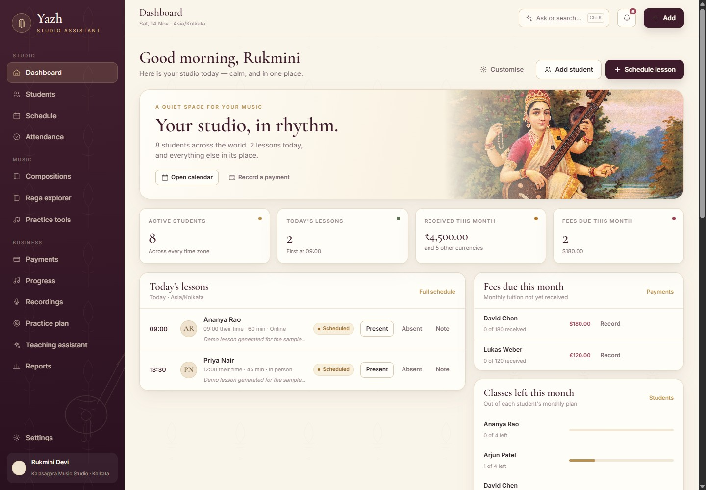
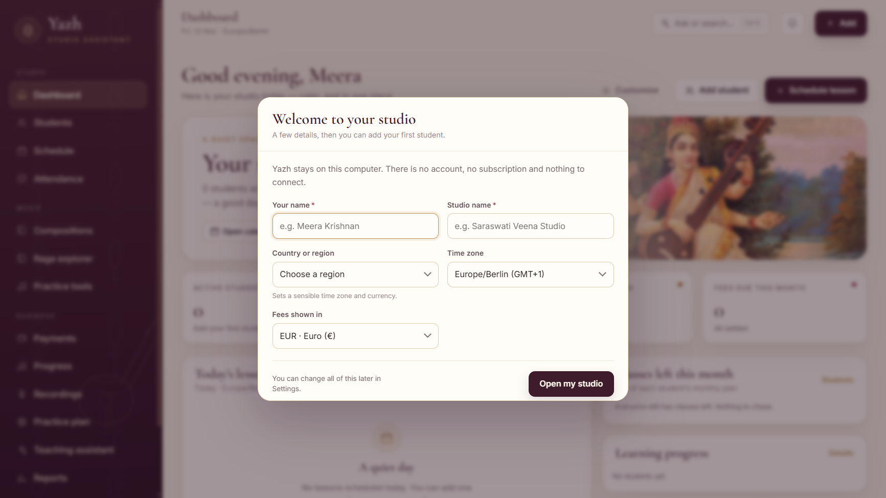
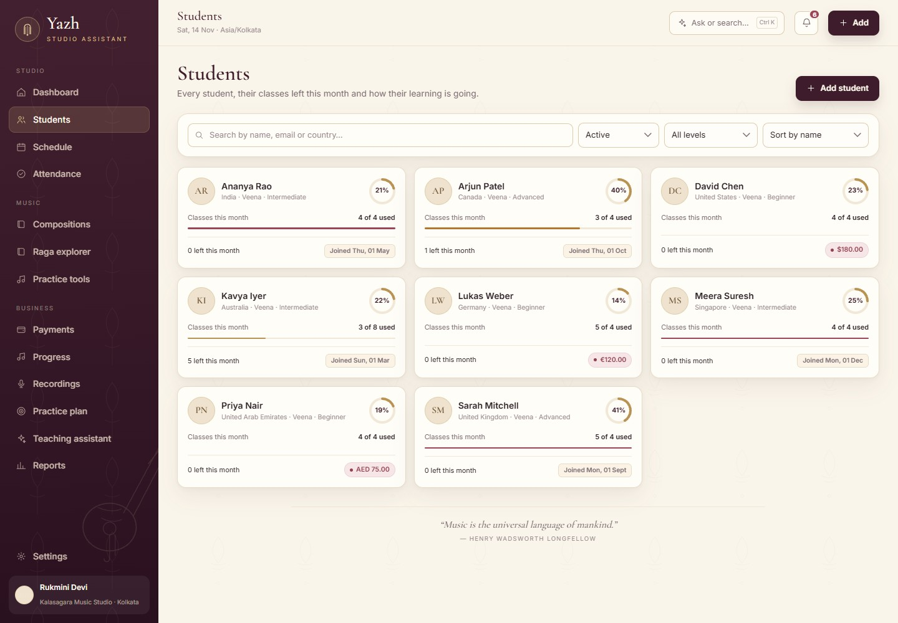
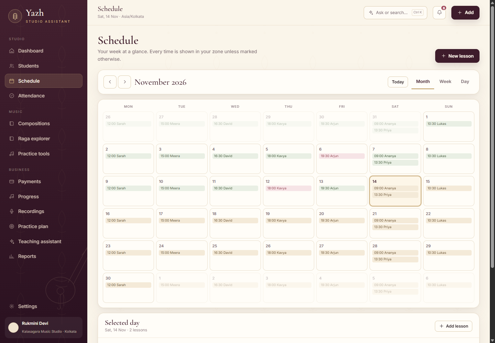
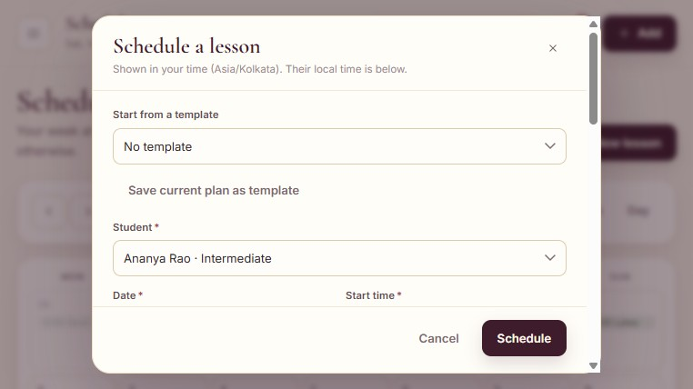
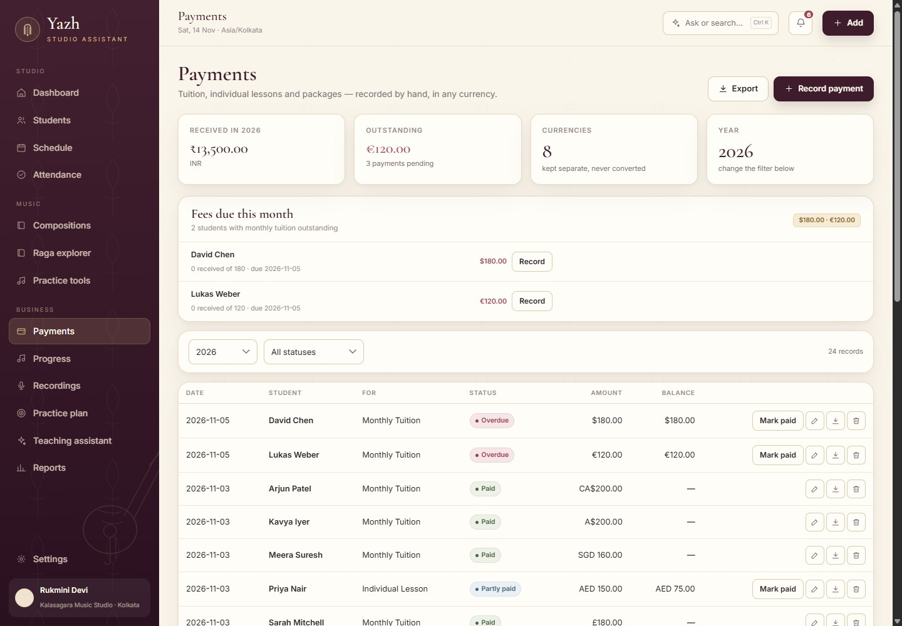
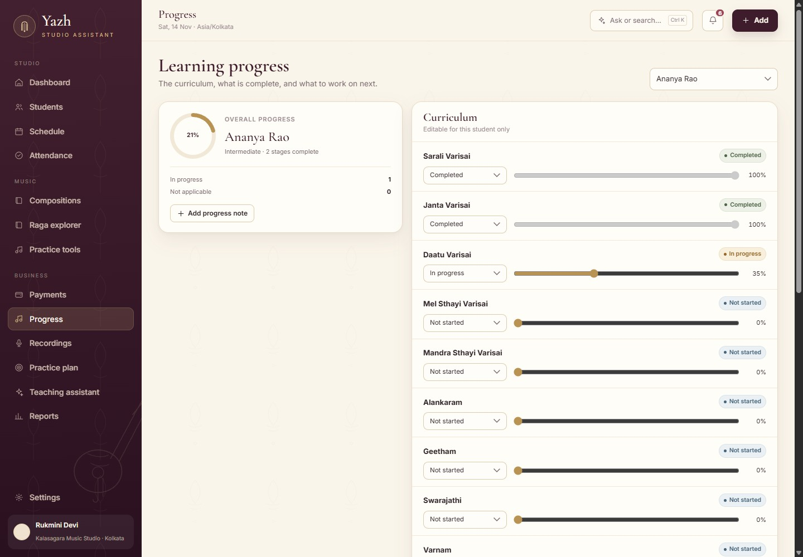
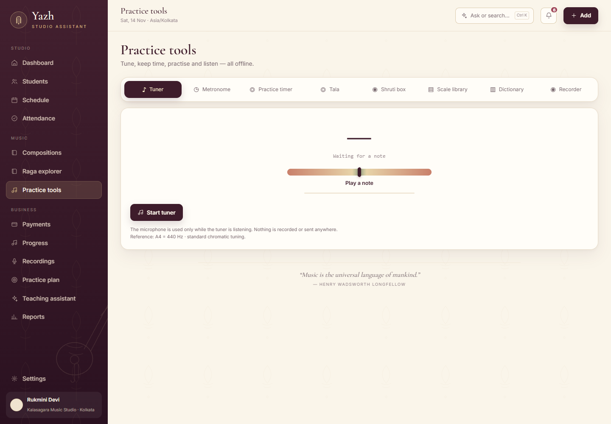
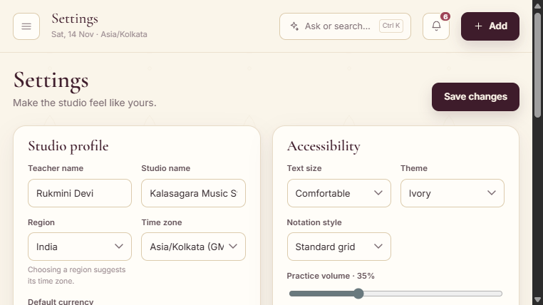

# Yazh — User Guide

A practical walkthrough of the studio. If you only read one page, read
[First run](#first-run) and [The daily rhythm](#the-daily-rhythm).

---

## Install

Yazh is one Windows portable file.

1. Download **`Yazh-1.18.0-portable.exe`** from the
   [releases page](https://github.com/nk12Kumar/yazh-releases/releases/latest).
2. Put it somewhere permanent, for example `Documents\Yazh\`.
3. Double-click it. There is no installer to run and no sign-in.

Windows may show **“Windows protected your PC”** because the app is not
code-signed. Choose **More info → Run anyway**.

The macOS `.dmg` is delayed while the hosted Mac build runner is unavailable.

### Updating

Download the newer `.exe` and replace the old one. Your studio data stays in a
separate folder, so replacing the app does **not** reset your students. Yazh
saves a dated database snapshot in `data/backups` before the first upgrade
migration.

---

## First run

Yazh opens with a short studio setup:

- **Your name** — used on the dashboard greeting.
- **Studio name** — shown in the sidebar and receipts.
- **Region** — suggests a time zone.
- **Time zone** — your local teaching time.
- **Default currency** — used for new students and payments.

Choose **Open my studio**. You will land on an empty dashboard with one clear
next step: **Add student**.

There are no demo students, sample payments or placeholder lessons. To start
over later, use **Settings → Data → Restore database** with a backup, or delete
the data folder after closing the app.

> **No password.** Yazh is a local app. Anyone who can open your Windows account
> can open Yazh; use your operating-system lock if the computer is shared.

---

## The daily rhythm

1. Open Yazh. **Today's lessons** and **Fees due this month** are on the
   dashboard.
2. Mark a lesson **Present**, **Absent** or **Cancelled** from the lesson row.
3. Add a lesson with **+ Add → Schedule lesson**.
4. Record money with **+ Add → Record payment**.
5. Open a student card to see their lessons, progress and balance.

The **+ Add** button in the top-right corner is the quickest way to add a
student, lesson or payment. Press **Ctrl/Cmd + K** to search or ask the studio
assistant.

---

## Dashboard

The first screen answers four questions:

- **Active students** — who is currently learning with you.
- **Today's lessons** — what is happening today in your time zone.
- **Received this month** — payments recorded in this month.
- **Fees due this month** — tuition still outstanding, calculated from each
  student's monthly fee and the payments received.

Below the summary:

- **Today's lessons** — mark attendance or open a lesson note directly.
- **Fees due this month** — record a payment from the list.
- **Classes left this month** — spot students who are close to using up their
  monthly plan.
- **Learning progress** — the next stages to work on.
- **Recently opened compositions** — jump back to a piece you were teaching.
- **Customise** — choose which cards appear and in what order.

A daily music quote and Thirukkural verse sit at the foot of the page.

---

## Students

**Students → + Add student** creates a profile with:

- full name, country and time zone;
- instrument (Veena, violin, piano, voice — anything);
- learning level and contact details;
- classes per month and monthly fee;
- lesson frequency and length;
- an optional photo.

Each card shows the instrument, level, classes used this month, classes left and
any outstanding balance. Use the search box for a name, email or country; filter
by status or level; sort by name or join date.

Open a student to see:

- their next lesson and class balance;
- lesson history with attendance;
- progress notes and curriculum stages;
- payments and receipts;
- contact details and private teacher notes;
- **Record payment**, **Schedule lesson** and **Edit profile**.

Archive a student who has stopped rather than deleting their history. Archived
students are hidden from the active list.

---

## Schedule and lesson plans

The Schedule has **month**, **week** and **day** views. Select a day to add a
lesson. A lesson stores:

- student, date, start time and length;
- online or in-person, plus a meeting link;
- one-off, weekly or fortnightly repeat;
- objective, homework and notes;
- raga, tala and a linked composition;
- an exercise from the practice plan;
- a revision reminder.

Double-booking is blocked. Times are stored in UTC and displayed in your time
zone; while scheduling, the student's local time is shown underneath so you do
not have to calculate it.

You can save a lesson setup as a **template** and apply it to future lessons.
Reschedule from the lesson menu; cancel with a reason.

---

## Attendance and make-up credits

Mark a lesson:

- **Present** — the class happened.
- **Absent** — the student missed it.
- **Cancelled** — the class will not happen.
- **Rescheduled** — moved to another date.
- **Completed** — finished, with any note.

Cancelling a lesson creates a **make-up credit** for that student. Use or waive
it from the student page or the attendance screen. Credits are counted in the
class balance so you can see what you owe without a separate spreadsheet.

---

## Payments

Record a payment with:

- student and amount;
- currency;
- kind — monthly tuition, individual lesson or package;
- status — paid, pending, overdue or partly paid;
- due date and paid date;
- method and reference.

The Payments page groups **Received**, **Pending**, **Overdue** and **Fees due
this month**. Click a payment to edit it or download a receipt.

A receipt is a local PDF with your studio name, student, amount, currency,
payment method and receipt number. Use **Export** to download the payment list
as CSV.

Monthly dues are calculated automatically: active monthly students × their fee,
minus what has been received this month. You do not need to create an invoice
before a payment.

---

## Progress

Every student gets an editable **11-stage Carnatic path**:

1. Sarali Varisai
2. Janta Varisai
3. Alankaram
4. Geetham
5. Swarajathi
6. Varnam
7. Keerthanam
8. Kriti
9. Ragam–Thanam–Pallavi
10. Neraval & Swarakalpana
11. Manodharma

Each stage can be **not started**, **in progress**, **needs revision**,
**completed** or **not applicable**. Rename a stage, add a custom stage for one
student, and set a progress percentage.

**Add progress note** records a dated observation: raga, technique, practice,
assessment or a general note. Practice notes can carry a due date and remain
open until done.

Teachers of other instruments can rename the stages or add their own.

---

## Reports

Reports summarise:

- revenue by month;
- lessons taught and attendance rate;
- student growth;
- outstanding fees by student;
- progress by stage;
- countries and time zones;
- practice activity.

**Studio report** downloads a PDF; **CSV** opens in a spreadsheet. **Student
report** produces a printable month report with lessons, attendance, milestones,
completed compositions, pending exercises and practice history.

---

## Compositions and notation

The composition library stores:

- title, composer, raga and tala;
- Pallavi, Anupallavi, Charanam, Chittaswaram and Swarakalpana;
- lyrics and swara notation;
- favourite flag and teaching notes;
- a student assignment;
- optional audio and PDF attachments.

The **notation grid** places one cell per beat and marks tala divisions. Print a
clean composition PDF from the composition page. Completion can be marked per
student when the piece is learned.

Recordings can be linked to a composition and a student, so a take sits beside
the piece it belongs to.

---

## Recordings

Record directly in the app or upload an audio file:

- attach it to a student and optionally a composition;
- add feedback;
- play it back;
- compare two takes;
- download the audio.

Recordings are stored in the local data folder. They are never uploaded.

---

## Practice tools

A separate section keeps these away from the studio screens:

- **Tuner** — microphone pitch detection with cents display.
- **Metronome** — tempo, beats per bar and click sound.
- **Tala simulator** — Adi, Rupaka, Misra Chapu, Khanda Chapu, Eka, Jhampa,
  Triputa, Ata and custom talas, with nadai and visual beats.
- **Shruti box** — Sa–Pa–Sa or Sa–Ma–Sa drone, tonic and volume.
- **Practice timer** — a simple session timer.
- **Scale library** — Western and Carnatic scales.
- **Music dictionary** — common terms in plain language.
- **Quick recorder** — capture an idea without leaving the tools page.

These use the browser audio engine. If the microphone is blocked, check the
operating-system microphone permission for Yazh.

---

## Raga explorer

Browse the **72 Melakarta ragas** and common **janya ragas**. Each entry shows:

- arohanam and avarohanam;
- chakra and parent Melakarta;
- characteristic prayogas;
- gamaka notes;
- related compositions;
- favourite and private teaching notes;
- a comparison view for two ragas.

The raga data is bundled locally; no internet connection is needed.

---

## Teaching assistant

The assistant answers questions about your own studio — fees due, classes left,
today's lessons, progress — using the local database. It can also draft a lesson
plan or explain a music term.

- **Offline mode** is the default and needs no key.
- **Ollama** can be used if it is already running locally.
- **Gemini** is optional; the key is kept only for the session and never saved.

The assistant is a helper, not an authority. Always check music theory, notation
and student-facing advice yourself. Answers include a verification reminder.

---

## Settings and backups

**Studio profile** — teacher name, studio name, region, time zone and currency.

**Appearance** — text size, theme (Ivory, Sand, Night), notation density and
practice volume. High contrast is available for low-vision use.

**Date and time** — date format, 12/24-hour time and week start.

**Language** — English or Tamil interface labels. Student names, notes and
content remain exactly as you typed them.

**Data**

- **Download backup** — a copy of the SQLite database.
- **Save backup copy** — choose where to save it.
- **Restore database** — restore on the next app start.
- **Export everything** — a ZIP with the database, uploads, settings and a
  manifest.
- **Import full backup** — stage a ZIP for restore; close and reopen Yazh.

Yazh creates an automatic daily backup and keeps the last 14. The Settings page
shows the last backup date and size.

**Updates** — **Check for updates** contacts GitHub only when you press it. It
does not send studio data. Yazh does not auto-update itself; download a new
portable file when one is available.

### Where the data lives

| Windows | macOS |
|---|---|
| `%APPDATA%\Yazh\data` | `~/Library/Application Support/Yazh/data` |

To move the studio to another computer, close Yazh, copy the whole `data` folder,
and put it in the same place on the new computer. Or use **Export everything**
and **Import full backup**.

---

## Feature list

| Area | What you can do |
|---|---|
| **Studio setup** | Teacher, studio, region, time zone, currency; no demo data |
| **Dashboard** | Today's lessons, fees due, classes left, progress, recent compositions, custom cards |
| **Students** | Add, edit, archive, photo, instrument, level, fee, contact, search, filters |
| **Classes** | Monthly plan, used/booked/remaining, make-up credits |
| **Schedule** | Month/week/day, weekly/fortnightly, time zones, reschedule, double-booking guard, meeting links |
| **Lessons** | Objective, homework, raga, tala, composition, exercise, notes, templates |
| **Attendance** | Present, absent, cancelled, rescheduled, completed |
| **Payments** | Tuition, individual lessons, packages, part-payments, dues, receipts, CSV |
| **Progress** | 11 Carnatic stages, custom stages, revision, dated notes, per-student report |
| **Reports** | Revenue, lessons, attendance, growth, outstanding, progress, countries; PDF/CSV |
| **Compositions** | Sections, lyrics, notation grid, PDF, audio/PDF attachments, favourites, assignment |
| **Recordings** | Record/upload, student/composition link, feedback, compare, download |
| **Practice tools** | Tuner, metronome, tala, shruti, timer, scales, dictionary, quick recorder |
| **Raga explorer** | 72 Melakarta, janya ragas, prayogas, gamaka notes, comparison, notes |
| **Assistant** | Offline studio answers, optional Ollama/Gemini, lesson-plan drafts |
| **Settings** | Themes, text size, volume, date/time, language, backups, restore, update check |
| **Privacy** | Local SQLite, loopback-only API, no telemetry, no cloud account |

> **Materials were removed in 1.18.0.** The section did not work reliably enough
> to keep. The studio now focuses on lessons, fees, progress and practice.

---

## Troubleshooting

**Windows says “Windows protected your PC.”**
The app is unsigned. Choose **More info → Run anyway**. The download is a single
portable `.exe`; no installer is needed.

**The app opens with a welcome screen instead of my dashboard.**
That is the first-run setup. Complete your name and studio details. If you have
just replaced an old build and still see demo students, remove the old `data`
folder only if you are sure it contains nothing you need — or restore a backup
from Settings.

**I cannot hear the metronome or shruti box.**
Check the master volume in Settings and your Windows volume mixer. The tuner
needs microphone permission; Windows Settings → Privacy → Microphone.

**A page is slow the first time.**
Heavy pages (Raga explorer, Practice tools, Compositions) load on demand. The
dashboard is kept light.

**The Mac app is not on the releases page.**
The Windows app is available now. The macOS build is delayed by GitHub's hosted
runner and will be added when it is available.

**How do I start over completely?**
Close Yazh. Copy or rename `%APPDATA%\Yazh\data` (Windows) or
`~/Library/Application Support/Yazh/data` (macOS), then reopen Yazh. A fresh
empty studio and the first-run setup appear. Keep the copy if you may want the
old studio back.

---

## Privacy

- All data stays in the local SQLite database.
- The local API is bound to `127.0.0.1`; it is not reachable from your network.
- There is no account, no password, no telemetry and no advertising.
- Uploads and recordings are stored in the local data folder.
- The assistant is offline by default. Ollama and Gemini are opt-in.

Artwork: public-domain paintings by Raja Ravi Varma. See
[`CREDITS.md`](CREDITS.md). Thirukkural: Tamil corpus CC0; English translation
by G. U. Pope (1886), public domain.

---

_Yazh 1.18.0 · Studio Assistant_
