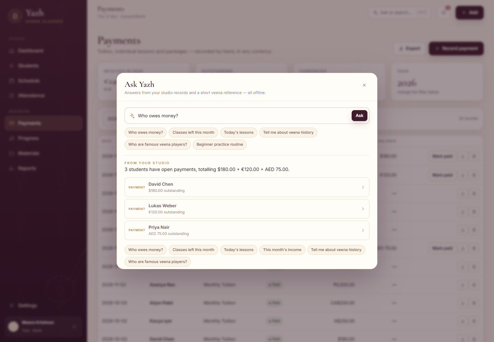

# Yazh — Veena Classes · downloads

A calm, offline studio app for a veena teacher: students, lessons, attendance,
class balances and payments. Nothing to install, nothing uploaded, no internet
needed.

**[⬇ Download the latest build](https://github.com/wolfxwxjr/yazh-releases/releases/latest)**

---

## Which file?

| File | What it does |
|---|---|
| **`Yazh-1.1.0-portable.exe`** | Opens with a demo studio — 8 fictional students, lessons and payments, so you can try everything |
| **`Yazh-1.1.0-empty.exe`** | Opens with an empty studio — sign in and add your own students |
| **`Yazh-1.1.0-universal.dmg`** | Mac version (unsigned, built when the macOS workflow succeeds) |
| **`SHA256SUMS.txt`** | Checksums to verify the downloads |

Double-click the `.exe`. There is no installer and no setup wizard.

> **Windows warning:** the app is not code-signed, so SmartScreen may say
> “Windows protected your PC”. Click **More info → Run anyway**. Code-signing
> certificates are a paid service; this does not mean the file is unsafe.
>
> **Mac:** Gatekeeper will block an unsigned app. Right-click → **Open** →
> **Open** again, or allow it in System Settings → Privacy & Security.

## Sign in

```
Email:    teacher@yazh.app
Password: Veena@2026
```

All data stays on your computer, in `%APPDATA%\Yazh\data` (Windows) or
`~/Library/Application Support/Yazh/data` (Mac). No account is created online.


---

## What's inside

### Studio
- **Dashboard** — active students, today's lessons, this month's income, pending
  payments, classes left, upcoming lessons and recent activity, all calculated
  from your own records.
- **Students** — one **+ Add student** button; photo, contact, country, time zone,
  level, classes per month, fee and payment arrangement.
- **Classes remaining** — each student card shows used, booked and remaining
  classes for the current month.
- **Student page** — lesson history, attendance, payments, curriculum progress,
  teacher notes and profile details.

### Teaching
- **Schedule** — month, week and day views; one-off, weekly or fortnightly
  lessons; reschedule; meeting links; in-person or online.
- **Double-booking protection** — the app refuses overlapping lessons.
- **Time zones** — store once in UTC, see it in your time, and see the student's
  local time while scheduling (e.g. “13:30 her time”).
- **Attendance** — present, absent, cancelled, rescheduled or completed, from the
  dashboard, calendar or attendance page.
- **Progress** — Carnatic stages from Sarali Varisai through Kriti, with
  percentages and dated notes on ragas, talas, technique and practice.

### Money
- **Payments** — monthly tuition, individual lessons and packages; 13 currencies
  kept separate (never silently converted); paid, pending, overdue or partly
  paid; outstanding balances.
- **Receipts** — a PDF receipt for any payment.
- **CSV export** — the year's payments for your own records.

### Extras
- **Ask Yazh** — press **Ctrl/Cmd + K** and ask “who owes money?”, “classes left
  for Ananya”, “today's lessons”, “this month's income”, or ask about veena
  history, famous players, tuning and beginner practice. Studio answers come from
  your data; the veena notes are a short offline reference. No AI service, no key,
  no internet.
- **Thirukkural of the day** — Tamil verse with G. U. Pope's 1886 English
  translation on the login screen and dashboard.
- **Notifications** — in-app reminders for tomorrow's lessons, overdue payments
  and missed lessons.




---

## A simple daily rhythm

1. Open the app. Today's lessons and classes left are on the first screen.
2. Tap **Present** or **Absent** on the lesson row.
3. **+ Add → Schedule lesson** for a new class; the student's local time appears
   under the form.
4. **+ Add → Record payment** when money arrives; download the receipt.
5. Open a student card for their history and progress.
6. **Ctrl/Cmd + K** for a quick question.

## Where your data lives

| Windows | Mac |
|---|---|
| `%APPDATA%\Yazh\data` | `~/Library/Application Support/Yazh/data` |

Close the app and copy that folder to back everything up. Delete or rename it to
start fresh; the app recreates the database on the next launch.

## Version 1.1.0

- Ask Yazh assistant and veena reference
- Daily Thirukkural on login and dashboard
- Empty-studio build
- Fixed a crash when leaving a student page for the schedule
- Error boundary so a failed screen never leaves a blank window
- Mac build workflow

Previous: **1.0.0** — first portable Windows build.

## Verify a download

```powershell
Get-FileHash .\Yazh-1.1.0-portable.exe -Algorithm SHA256
```

Compare with `SHA256SUMS.txt` in the release. GitHub's asset digest is the same
hash.

## Privacy

- Local SQLite database; no telemetry, analytics or third-party runtime requests.
- The app runs a private server bound to `127.0.0.1`.
- No student information is uploaded anywhere.

This repository contains **downloads only**. The application source is kept in a
private repository.

---

Yazh · Veena Classes · 1.1.0
