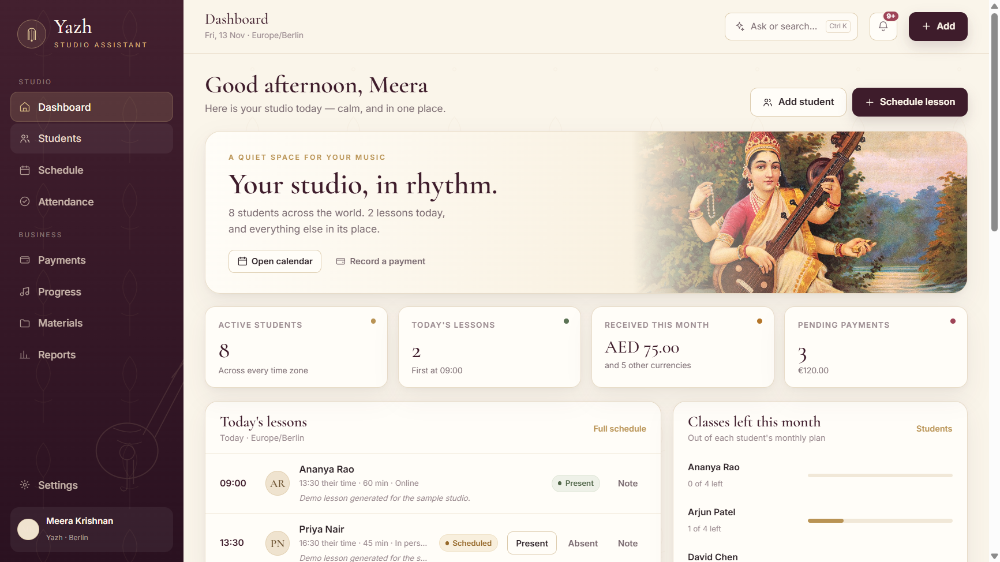
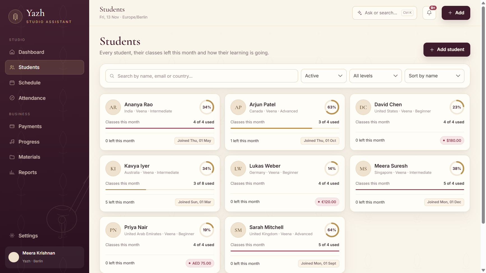
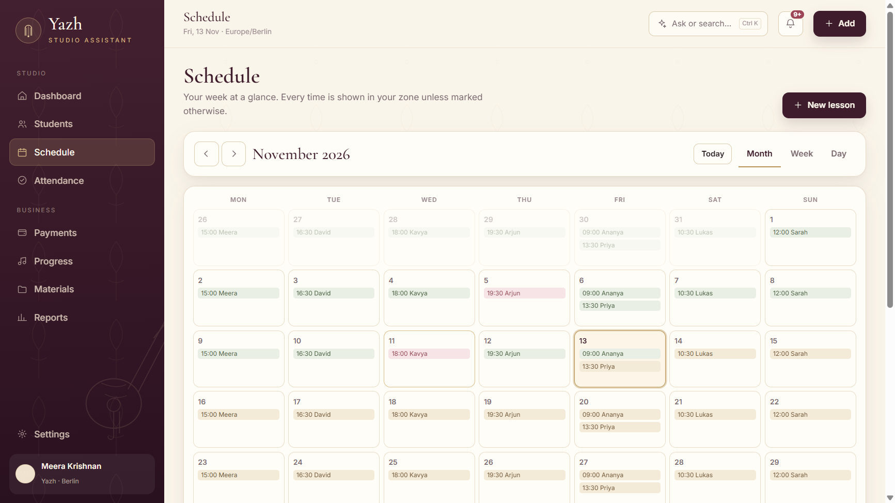
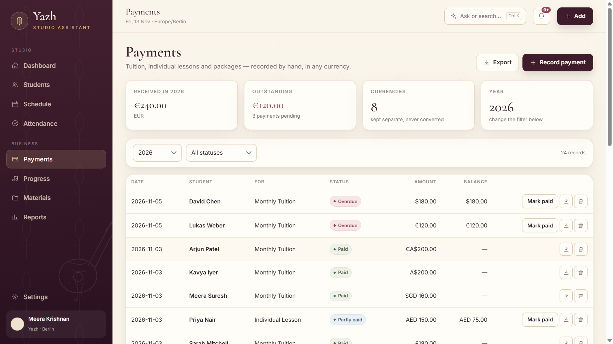
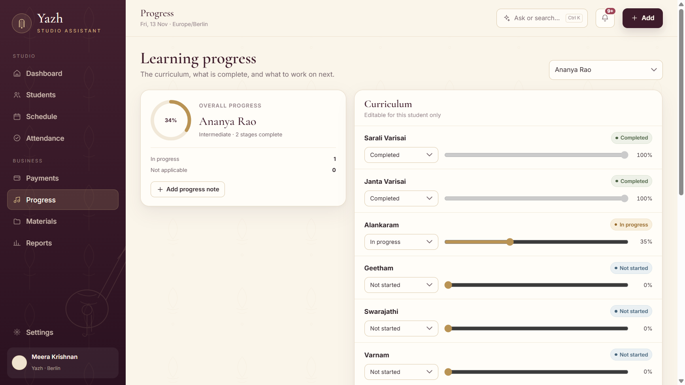
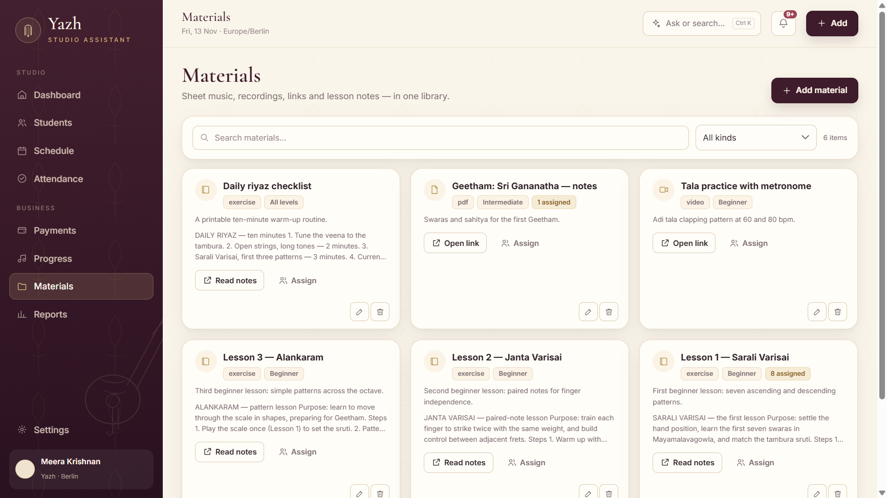
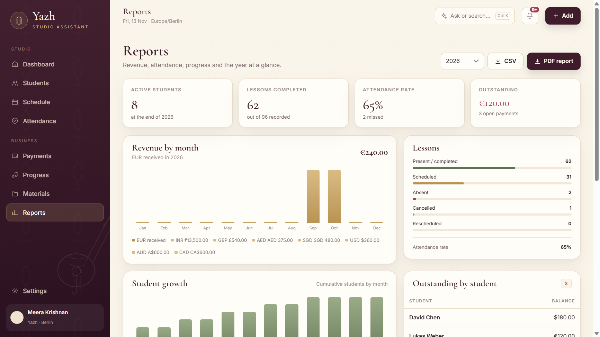
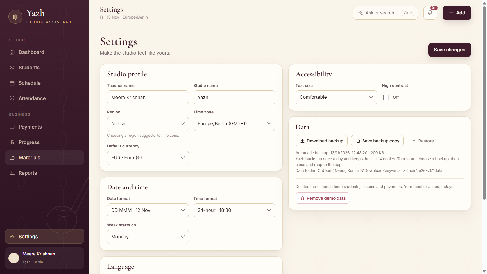
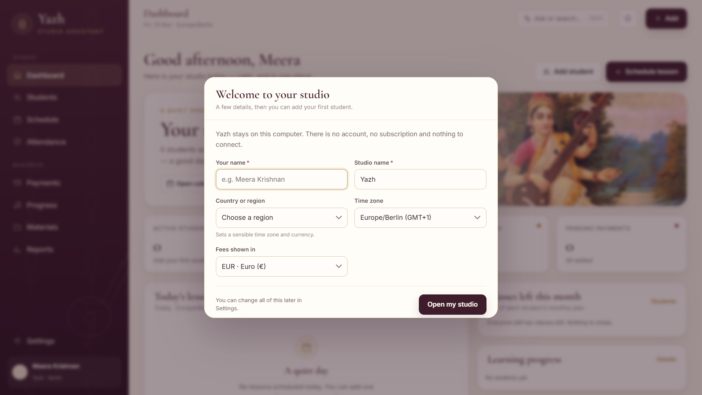

# Yazh — Studio Assistant · downloads

A calm, offline studio for private music teachers: students, lessons, attendance,
class balances, payments, materials and progress. No account, no sign-in, no
subscription, no telemetry.

**[⬇ Download the latest build](https://github.com/wolfxwxjr/yazh-releases/releases/latest)**

---

## Which file?

| File | What it does |
|---|---|
| **`Yazh-1.3.0-portable.exe`** | Demo studio — 8 fictional students, lessons and payments to try everything |
| **`Yazh-1.3.0-empty.exe`** | Empty studio — opens with a short setup, ready for your own students |
| **`Yazh-1.3.0-universal.dmg`** | macOS, universal (Intel + Apple Silicon), unsigned |
| **`SHA256SUMS.txt`** | Checksums for verification |

Double-click the `.exe`. There is no installer, no setup wizard and **no login
screen**.

> **Windows warning:** the app is not code-signed, so SmartScreen may say
> “Windows protected your PC”. Click **More info → Run anyway**.
>
> **Mac:** open the DMG, drag **Yazh** to Applications, then right-click → **Open**
> the first time. Gatekeeper blocks unsigned apps by default.

## Your data

Everything stays on your computer:

| Build | Folder |
|---|---|
| Demo | `%APPDATA%\Yazh\data` |
| Empty | `%APPDATA%\Yazh Empty\data` |
| Mac | `~/Library/Application Support/Yazh/data` |

No cloud account, no telemetry, no student data uploaded. The desktop shell
blocks every network request except the local studio API. Settings offers
**Download backup**, **Backup now** and **Restore**.

Because there is no password, use your computer's account lock if the machine is
shared. Data lasts until you delete it — see the privacy note in the app/docs.

---

## What's inside

### Studio
- **Dashboard** — today's lessons, classes left, month's income, pending
  payments, upcoming lessons, progress rings and recent activity.
- **Students** — one **+ Add student** button; name, instrument, contact,
  country, time zone, level, classes per month, fee and payment arrangement.
- **Student page** — lessons, attendance, payments, curriculum, notes and details.

### Teaching
- **Schedule** — month, week and day views; weekly/fortnightly lessons;
  reschedule; online links; double-booking prevention.
- **Time zones** — stored in UTC, shown in your time, with the student's local
  time while scheduling.
- **Attendance** — present, absent, cancelled, rescheduled or completed.
- **Lesson notes** — what you covered and what to practise next.
- **Make-up credits** — cancelling creates a credit; redeem or waive it.
- **Progress** — editable curriculum (Carnatic stages as a starter), custom
  stages, and technique/repertoire/practice notes.
- **Materials** — PDFs, audio, video, images, links and written lesson notes,
  assigned to students.

### Money
- Monthly tuition, individual lessons and packages across **13 currencies**;
  paid, pending, overdue or partly paid; balances; PDF receipts; CSV export.
- **Reports** — revenue, lessons, attendance, student growth, outstanding
  balances, progress and countries, with **PDF and CSV** export.

### Extras
- **First-run setup** — name, studio, region, time zone, currency.
- **Automatic backups** — daily, last 14 kept, restore-on-restart.
- **Settings** — region, time zone, currency, date/time format, week start,
  text size, high contrast, language, demo cleanup.
- **Tamil** — navigation, page titles and settings labels (partial).
- **Ask Yazh** — `Ctrl/Cmd + K`: “who owes money?”, “classes left for Ananya”,
  “today's lessons”, plus a short veena reference.
- **Thirukkural** — a daily verse in Tamil with G. U. Pope's 1886 translation.











---

## A simple daily rhythm

1. Open the app — today's lessons and classes left are on the first screen.
2. Tap **Present** or **Absent** on the lesson row.
3. Add a note: what you covered, what to practise.
4. **+ Add → Schedule lesson**; the student's local time appears under the form.
5. **+ Add → Record payment**; download the receipt.
6. **Ctrl/Cmd + K** for a quick question.

## Version 1.3.0

- **For any instrument** — instrument field on every student; editable curriculum.
- **First-run setup** for the empty build.
- **Lesson notes** on any lesson.
- **Make-up credits** when a lesson is cancelled.
- **Automatic daily backups**, last-backup status and restore-on-restart.
- **Rebrand** — “Yazh — Studio Assistant”, for private music teachers.
- **Privacy enforcement** — localhost-only network block and `npm run privacy`.

Previous: **1.2.0** — no sign-in, Settings, Materials, Reports, Progress.
**1.1.1** — empty-profile fix and daily quotes. **1.0.0** — first build.

## Verify a download

```powershell
Get-FileHash .\Yazh-1.3.0-portable.exe -Algorithm SHA256
```

Compare with `SHA256SUMS.txt`. GitHub's asset digest is the same hash.

## Privacy

- Local SQLite database; no telemetry, analytics or third-party runtime requests.
- Private server bound to `127.0.0.1`; no network exposure.
- The renderer may only connect to the local studio.
- This repository contains **downloads only**; source is at
  [wolfxwxjr/yazh-studio](https://github.com/wolfxwxjr/yazh-studio) under MIT.

---

Yazh · Studio Assistant · 1.3.0
